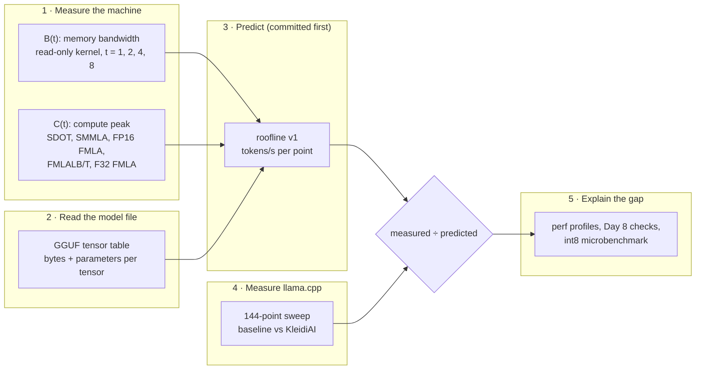
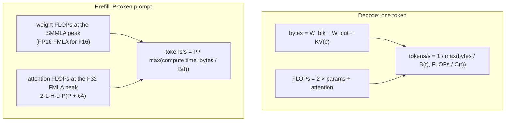
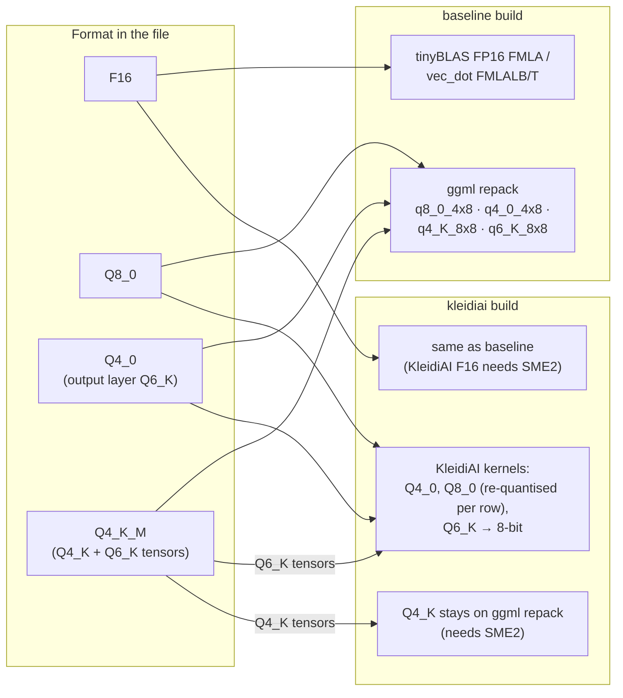
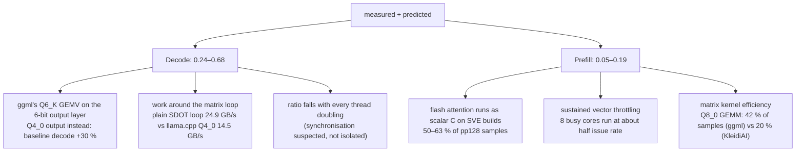
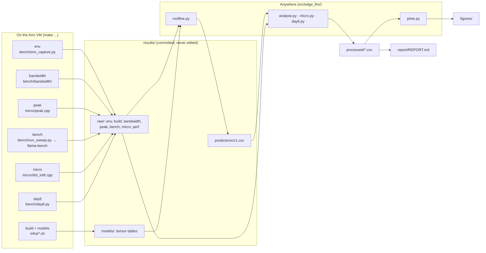

# edge-llm-on-arm

**LLM inference on an Arm CPU, predicted from first principles, then measured.**

Small language models now run on ordinary Arm CPUs, but a tokens/s figure alone does not say *why* a setup is as fast as it is, or how far it is from what the hardware allows. This project predicts llama.cpp's inference speed on an Arm Neoverse V2 CPU from the machine's **measured** memory bandwidth and compute peaks, measures it across 144 configurations (with and without Arm's KleidiAI kernels), and explains the gap down to individual kernels and instructions.

Full write-up: **[report/REPORT.md](report/REPORT.md)**. Design and data contracts: [ARCHITECTURE.md](ARCHITECTURE.md). Specification and decision log: [CLAUDE.md](CLAUDE.md).

## Result

On Google Axion (Arm Neoverse V2, `c4a-highcpu-8`), running Qwen3 0.6B in llama.cpp `ddf48f8`, over 144 measured points:

- **Decode does not reach the bandwidth roofline.** Measured ÷ predicted is 0.239–0.677, median 0.399; F16 and Q8_0 reach 0.48–0.68 at tg128, the 4-bit formats 0.29–0.46 (`results/processed/points.csv`, 48 decode rows; lowest `small_Q4_K_M_baseline_t8_tg128d2048`, highest `small_Q8_0_kleidiai_t1_tg128`). No point exceeds its prediction.
- **Prefill reaches 0.051–0.188 of the compute roofline,** median 0.091 (`points.csv`, 96 prefill rows). Memory traffic is at most 0.0194 of the bandwidth ceiling, so prefill is compute-side. In `perf` profiles of pp128 the flash-attention function, which runs as scalar code on this SVE build, takes 50.20–63.41 % of samples (`results/raw/perf/2026-11-04T1742Z/`).
- **KleidiAI helps unevenly.** Against ggml's own Arm kernels, Q8_0 prefill is up to 1.365× at pp128 (`results/processed/kleidiai.csv`, `small_Q8_0_t1_pp128`). Q4_0 decode is 1.067–1.191× at tg128 but Q4_0 prefill is 0.950–1.004×, slower at short prompts. The Q4_0 decode gain comes from the 6-bit output layer, not the 4-bit matrices: with that layer as Q4_0 the speed-up is 0.971 at t = 1 (`results/processed/day8_check_a.csv`, `Q4_0outq4`). The F16 negative control stays within 0.994–1.010 over 18 pairs.
- **At the instruction level**, int8 `SDOT` is 26.6× and `SMMLA` 53.0× faster than scalar code per multiply-accumulate while the data sits in L1; from DRAM every hand-written SIMD variant reads weights at the same 24.78–24.90 GB/s, so the instruction stops mattering (`results/processed/micro.csv`).
- **The predictions came first.** They are in commit `c29a00e`, the sweep records in `3d6690f` ([check it yourself](#predictions-before-measurements)).


*Each point is one configuration; the diagonal is ratio 1. Prefill and decode are kept apart. Source: `results/processed/points.csv`.*

## The method

Two numbers describe what a CPU can do for this workload: how fast it reads memory, and how fast it multiplies. Every model file states exactly how many bytes and multiply-adds one token needs. Dividing one by the other gives a ceiling on tokens/s before anything is run.



**Decode** (one new token) must read every weight once, and does one multiply-add per weight: it should be **memory-bound**. **Prefill** (the prompt) reuses each weight across every prompt token: it should be **compute-bound**. The model therefore predicts:



A ratio near 1 means the hardware sets the speed and only a smaller format or more bandwidth will help. A ratio far below 1 means time is lost in software, and the job is to find where. Every input is measured on the machine itself, never taken from a datasheet ([report §2–3](report/REPORT.md#2-measured-machine-limits)).

## What runs where

The two llama.cpp builds come from the same pinned commit and differ only in `-DGGML_CPU_KLEIDIAI=ON`. The baseline is not naive: ggml already repacks quantised weights for NEON `SDOT` and i8mm `SMMLA`. On this CPU (no SME), KleidiAI takes over some formats and not others, which turns the four formats into a ladder from "no KleidiAI" to "all KleidiAI":



F16 is the **negative control**: KleidiAI cannot touch it here, so any speed change would mean the builds differ in something else. It did not move (0.994–1.010).

## Where the time goes

The roofline says *how far* each phase is from the hardware limit; profiles and targeted experiments say *why*.



- **The 6-bit output layer.** Qwen3's GGUFs keep `output.weight` untied and in Q6_K for the 4-bit formats: 127.6 MB of the Q4_0 model's 375.4 MB of weights, read for every token. ggml's Q6_K GEMV is slow; requantising only that tensor to Q4_0 raises baseline decode at t = 1 from 37.59 to 48.99 tokens/s, and KleidiAI's whole Q4_0 decode gain disappears (`day8_check_a.csv`; ADR-027).
- **Scalar attention.** On SVE builds the SIMD GEMM helper of ggml's tiled flash attention is compiled out (`simd-gemm.h:8`); its disassembly has 3 scalar `fmadd` and no vector FMA. It takes half or more of prefill time at pp128 (profiled at that length only; the prefill ratio falls as prompts grow) (`results/raw/perf/2026-11-04T1742Z/`, `results/raw/peak/2026-11-02T2141Z_ggml_f16_instructions.json`).
- **Throttling.** Under dense vector load each core runs either at 4 or at exactly 2 vector instructions per cycle; with all 8 cores busy, almost always at 2 (`results/raw/peak/2026-11-02T2141Z.json`). The cause (likely power management of high-power vector instructions) is not confirmed.

Each gap source named before measuring is marked *measured*, *supported* or *not measured* in [report §5](report/REPORT.md#5-gap-accounting).

## KleidiAI against baseline

KleidiAI ÷ baseline speed-up of medians, with the conservative range in brackets. Each cell shows t = 1, then t = 8. F16 is the negative control. Q4_K_M is a partial case (only its Q6_K tensors move to KleidiAI). All values: `results/processed/kleidiai.csv`, `pair_id` = `small_<format>_t<t>_<test>`.

| Format | Prefill, pp128 | Prefill, pp2048 | Decode, tg128 |
|---|---|---|---|
| F16 (control) | 0.999 (0.999–0.999)<br>1.006 (1.002–1.009) | 1.010 (1.009–1.011)<br>1.005 (1.002–1.013) | 1.000 (1.000–1.000)<br>0.999 (0.996–1.001) |
| Q8_0 | 1.365 (1.365–1.366)<br>1.316 (1.314–1.317) | 1.044 (1.040–1.045)<br>1.037 (1.035–1.048) | 1.101 (1.096–1.102)<br>1.097 (1.089–1.105) |
| Q4_0 | 0.950 (0.950–0.950)<br>0.957 (0.955–0.958) | 0.993 (0.992–0.993)<br>0.986 (0.986–0.990) | 1.177 (1.177–1.179)<br>1.067 (1.058–1.078) |
| Q4_K_M (partial) | 1.068 (1.067–1.070)<br>1.064 (1.063–1.065) | 1.011 (1.011–1.012)<br>1.012 (1.007–1.020) | 1.256 (1.255–1.256)<br>1.190 (1.175–1.202) |

The full table, with pp512 and decode after a 2048-token context, is Table 2 of the [report](report/REPORT.md#rq3-kleidiai-against-ggmls-own-arm-kernels).


## Instruction level: int8 SIMD in cache and from DRAM

A one-core int8 matrix–vector product (K = 4096) in five variants — scalar (auto-vectorisation off), GCC auto-vectorised, NEON `SDOT`, i8mm `SMMLA`, SVE `SDOT` — every one bit-identical to scalar before it is timed, with the disassembly of each hot loop committed in `micro/disasm/`.

| Variant | L1: GMAC/s | × scalar | DRAM: weight GB/s | × scalar |
|---|---|---|---|---|
| scalar | 2.6 | 1.0 | 2.51 | 1.0 |
| auto-vectorised | 37.8 | 14.5 | 23.22 | 9.3 |
| `SDOT` | 69.5 | 26.6 | 24.90 | 9.9 |
| `SMMLA` | 138.6 | 53.0 (per MAC) | 24.80 | 9.9 (per weight byte) |
| SVE `SDOT` | 63.4 | 24.3 | 24.85 | 9.9 |

*Source: `results/processed/micro.csv`. `SMMLA` multiplies two activation vectors at once, so it does twice the MACs per weight byte — the reason it suits prefill, not decode. SVE is 128 bits wide on this core, the same as NEON, so it does not win on width.*


## Research questions

Each verdict and its evidence is in the [report](report/REPORT.md).

1. **RQ1, decode is bandwidth-bound: not supported for this model size.** Decode sits at 0.24–0.68 of the memory ceiling and below the compute ceiling too ([RQ1](report/REPORT.md#rq1-decode-and-the-bandwidth-ceiling)).
2. **RQ2, prefill is compute-bound: partially supported.** It is compute-side, but reaches only 5–19 % of the roofline, with about half the time in scalar attention ([RQ2](report/REPORT.md#rq2-prefill-and-the-compute-ceiling)).
3. **RQ3, KleidiAI effect: partially supported.** The effect is measured per format and phase and the F16 control is flat, but the roofline does not predict where it helps, and on pure Q4_0 matrices KleidiAI is slower ([RQ3](report/REPORT.md#rq3-kleidiai-against-ggmls-own-arm-kernels)).
4. **RQ4, instruction level: partially supported.** In cache `SDOT` is 26.6× and `SMMLA` 53.0× scalar per MAC; from DRAM every hand-written SIMD variant reads 24.78–24.90 GB/s. The in-cache gain does not predict the prefill result ([RQ4](report/REPORT.md#rq4-instruction-level); `results/processed/micro.csv`).

## What this is not

- One machine (Google Axion, `c4a-highcpu-8`), one model size (Qwen3 0.6B), batch 1. Larger models and other chips are not measured.
- Not an accuracy study. KleidiAI re-quantises Q8_0 rows at load; perplexity was not checked.
- Not a leaderboard. The point is the gap between measured and predicted speed, not which setup is fastest.
- A cloud VM shares its host with other customers; memory bandwidth varied between sessions (see the report's limitations).

## How the code fits together

Everything that runs on the VM writes an immutable raw JSON record; everything after that is plain Python that can run anywhere from committed files.



Rules that keep it honest: raw records are append-only and a bad run is excluded by a named rule in code, never deleted; predictions are committed before the measurements they predict; every number in the report cites the CSV row (`config_id`) or raw file it comes from. Details: [ARCHITECTURE.md](ARCHITECTURE.md).

```
CLAUDE.md, ARCHITECTURE.md   the spec and decision log; how the parts connect
configs/                     sweep.yaml (what is measured), machine.yaml (VM facts)
infra/, bench/               VM set-up, llama.cpp builds, sweep runner, bandwidth kernel
micro/                       peak.cpp (C(t)), dot_int8.cpp (RQ4), committed disassembly
src/edge_llm/                roofline, analysis, plots (plain Python, tested in CI)
results/                     raw/ (never edited), models/, predictions/, processed/
figures/, report/            outputs: figures, REPORT.md
tests/                       pytest
```

## Reproduce

Anywhere (no cloud account, no model weights): the tables and figures come from committed files.

```
pip install -e ".[dev]"       # Python 3.12, pinned dependencies
make test                     # unit tests (hardware tests are skipped)
make analyse figures          # results/processed/ and figures/ from committed raw records
```

The measurements need a Google Cloud `c4a-highcpu-8` VM (Ubuntu 24.04, `us-central1`). On it, from a clean, pushed checkout:

```
bash infra/setup_vm.sh && make env build models           # toolchain, both builds, every model format
make bandwidth PHASE=start && make peak && make predict   # B(t), C(t), v1 predictions (commit these)
make bench SET=full && make bandwidth PHASE=end           # the 144-point sweep
make analyse figures                                      # measured ÷ predicted, KleidiAI pairs, plots
make micro                                                # RQ4 int8 microbenchmark (a further VM step)
```

`make predict` reads the bandwidth and peak records named at the top of `src/edge_llm/roofline.py`; point those at your own session's records. `make analyse` reads the sweep session `2026-11-02T2215Z` by default; pass `SESSION=<id>` for another. [ARCHITECTURE.md](ARCHITECTURE.md) explains every make target. On another Arm machine the method is the same: measure `B(t)` and `C(t)`, read the model's tensor table, predict, then measure.

### Predictions before measurements

The v1 predictions were committed before any full-sweep record existed. To check:

```
git log -1 --format='%h %ad' --date=iso c29a00e     # predictions: results/predictions/v1.csv
git log -1 --format='%h %ad' --date=iso 3d6690f     # first full-sweep records: results/raw/bench/2026-11-02T2215Z/
git merge-base --is-ancestor c29a00e 3d6690f && echo "predictions come first"
git ls-tree -r --name-only c29a00e results/raw/bench | grep -c 2215Z    # prints 0
```

The sweep's own environment capture names `c29a00e` as its checkout, with `dirty: false` (`results/raw/env/2026-11-02T2215Z.json`).

## License

[MIT](LICENSE). llama.cpp, KleidiAI and the Qwen3 weights keep their own licences; none of them is redistributed here.
