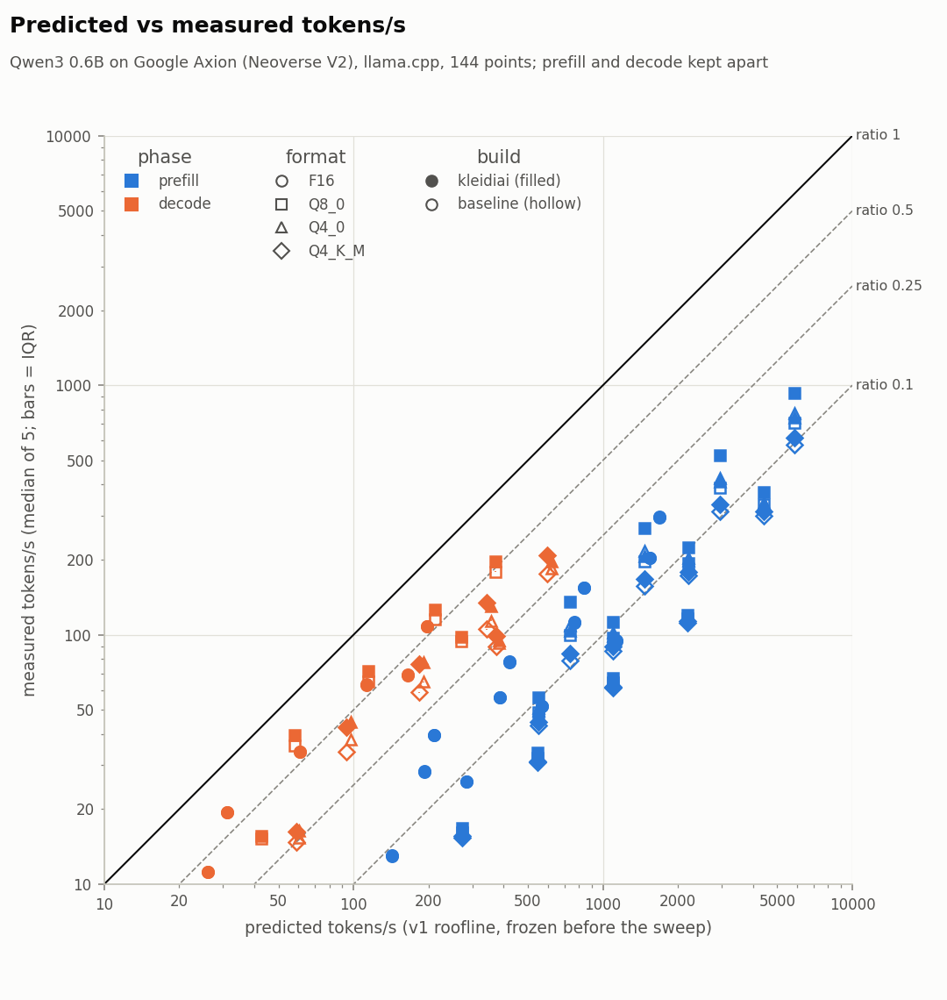

# edge-llm-on-arm

Small language models now run on ordinary Arm CPUs, but a tokens/s figure alone does not say *why* a setup is as fast as it is, or how far it is from what the hardware allows. This project predicts LLM inference speed on an Arm CPU from the hardware's measured memory bandwidth and compute peak, measures it with llama.cpp (with and without Arm's KleidiAI kernels), and explains the difference.

## Result

On Google Axion (Arm Neoverse V2, `c4a-highcpu-8`), running Qwen3 0.6B in llama.cpp `ddf48f8`, over 144 measured points:

- **Decode does not reach the bandwidth roofline.** Measured ÷ predicted is 0.239–0.677, median 0.399; F16 and Q8_0 reach 0.48–0.68 at tg128, the 4-bit formats 0.29–0.46 (`results/processed/points.csv`, 48 decode rows; lowest `small_Q4_K_M_baseline_t8_tg128d2048`, highest `small_Q8_0_kleidiai_t1_tg128`). No point exceeds its prediction.
- **Prefill reaches 0.051–0.188 of the compute roofline,** median 0.091 (`points.csv`, 96 prefill rows). Memory traffic is at most 0.0194 of the bandwidth ceiling, so prefill is compute-side. In `perf` profiles of pp128 the flash-attention function, which runs as scalar code on this SVE build, takes 50.20–63.41 % of samples (`results/raw/perf/2026-11-04T1742Z/`).
- **KleidiAI helps unevenly.** Against ggml's own Arm kernels, Q8_0 prefill is up to 1.365× at pp128 (`results/processed/kleidiai.csv`, `small_Q8_0_t1_pp128`). Q4_0 decode is 1.067–1.191× at tg128 but Q4_0 prefill is 0.950–1.004×, slower at short prompts. The Q4_0 decode gain comes from the 6-bit output layer, not the 4-bit matrices: with that layer as Q4_0 the speed-up is 0.971 at t = 1 (`results/processed/day8_check_a.csv`, `Q4_0outq4`). The F16 negative control stays within 0.994–1.010 over 18 pairs.
- **The roofline is predicted before it is measured.** Predictions are in commit `c29a00e`, the sweep records in `3d6690f` (see below).



*Each point is one configuration; the diagonal is ratio 1. Prefill and decode are kept apart. Source: `results/processed/points.csv`.*

## KleidiAI against baseline

KleidiAI ÷ baseline speed-up of medians, with the conservative range in brackets. Each cell shows t = 1, then t = 8. F16 is the negative control. Q4_K_M is a partial case (only its Q6_K tensors move to KleidiAI). All values: `results/processed/kleidiai.csv`, `pair_id` = `small_<format>_t<t>_<test>`.

| Format | Prefill, pp128 | Prefill, pp2048 | Decode, tg128 |
|---|---|---|---|
| F16 (control) | 0.999 (0.999–0.999)<br>1.006 (1.002–1.009) | 1.010 (1.009–1.011)<br>1.005 (1.002–1.013) | 1.000 (1.000–1.000)<br>0.999 (0.996–1.001) |
| Q8_0 | 1.365 (1.365–1.366)<br>1.316 (1.314–1.317) | 1.044 (1.040–1.045)<br>1.037 (1.035–1.048) | 1.101 (1.096–1.102)<br>1.097 (1.089–1.105) |
| Q4_0 | 0.950 (0.950–0.950)<br>0.957 (0.955–0.958) | 0.993 (0.992–0.993)<br>0.986 (0.986–0.990) | 1.177 (1.177–1.179)<br>1.067 (1.058–1.078) |
| Q4_K_M (partial) | 1.068 (1.067–1.070)<br>1.064 (1.063–1.065) | 1.011 (1.011–1.012)<br>1.012 (1.007–1.020) | 1.256 (1.255–1.256)<br>1.190 (1.175–1.202) |

The full table, with pp512 and decode after a 2048-token context, is Table 2 of the [report](report/REPORT.md#rq3-kleidiai-against-ggmls-own-arm-kernels).

## What this is not

- One machine (Google Axion, `c4a-highcpu-8`), one model size (Qwen3 0.6B), batch 1. Larger models and other chips are not measured.
- Not an accuracy study. KleidiAI re-quantises Q8_0 rows at load; perplexity was not checked.
- Not a leaderboard. The point is the gap between measured and predicted speed, not which setup is fastest.
- A cloud VM shares its host with other customers; memory bandwidth varied between sessions (see the report's limitations).

## Research questions

Each verdict and its evidence is in the [report](report/REPORT.md).

1. **RQ1, decode is bandwidth-bound: not supported for this model size.** Decode sits at 0.24–0.68 of the memory ceiling and below the compute ceiling too ([RQ1](report/REPORT.md#rq1-decode-and-the-bandwidth-ceiling)).
2. **RQ2, prefill is compute-bound: partially supported.** It is compute-side, but reaches only 5–19 % of the roofline, with about half the time in scalar attention ([RQ2](report/REPORT.md#rq2-prefill-and-the-compute-ceiling)).
3. **RQ3, KleidiAI effect: partially supported.** The effect is measured per format and phase and the F16 control is flat, but the roofline does not predict where it helps, and on pure Q4_0 matrices KleidiAI is slower ([RQ3](report/REPORT.md#rq3-kleidiai-against-ggmls-own-arm-kernels)).
4. **RQ4, instruction level: partially supported.** In cache `SDOT` is 26.6× and `SMMLA` 53.0× scalar per MAC; from DRAM every hand-written SIMD variant reads 24.78–24.90 GB/s. The in-cache gain does not predict the prefill result ([RQ4](report/REPORT.md#rq4-instruction-level); `results/processed/micro.csv`).

## Reproduce

Anywhere (no cloud account, no model weights): the tables and figures come from committed files.

```
pip install -e ".[dev]"       # Python 3.12, pinned dependencies
make test                     # unit tests (hardware tests are skipped)
make analyse figures          # results/processed/ and figures/ from committed raw records
```

The measurements need a Google Cloud `c4a-highcpu-8` VM (Ubuntu 24.04, `us-central1`). On it, from a clean, pushed checkout:

```
bash infra/setup_vm.sh && make env build models           # toolchain, both builds, every model format
make bandwidth PHASE=start && make peak && make predict   # B(t), C(t), v1 predictions (commit these)
make bench SET=full && make bandwidth PHASE=end           # the 144-point sweep
make analyse figures                                      # measured ÷ predicted, KleidiAI pairs, plots
make micro                                                # RQ4 int8 microbenchmark (a further VM step)
```

`make predict` reads the bandwidth and peak records named at the top of `src/edge_llm/roofline.py`; point those at your own session's records. `make analyse` reads the sweep session `2026-11-02T2215Z` by default; pass `SESSION=<id>` for another. [ARCHITECTURE.md](ARCHITECTURE.md) explains the data flow and every make target.

### Predictions before measurements

The v1 predictions were committed before any full-sweep record existed. To check:

```
git log -1 --format='%h %ad' --date=iso c29a00e     # predictions: results/predictions/v1.csv
git log -1 --format='%h %ad' --date=iso 3d6690f     # first full-sweep records: results/raw/bench/2026-11-02T2215Z/
git merge-base --is-ancestor c29a00e 3d6690f && echo "predictions come first"
git ls-tree -r --name-only c29a00e results/raw/bench | grep -c 2215Z    # prints 0
```

The sweep's own environment capture names `c29a00e` as its checkout, with `dirty: false` (`results/raw/env/2026-11-02T2215Z.json`).

### Layout

```
CLAUDE.md, ARCHITECTURE.md   the spec and decision log; how the parts connect
configs/                     sweep.yaml (what is measured), machine.yaml (VM facts)
infra/, bench/               VM set-up, llama.cpp builds, sweep runner, bandwidth kernel
micro/                       peak.cpp (C(t)), dot_int8.cpp (RQ4), committed disassembly
src/edge_llm/                roofline, analysis, plots (plain Python, tested in CI)
results/                     raw/ (never edited), models/, predictions/, processed/
figures/, report/            outputs: figures, REPORT.md
tests/                       pytest
```
