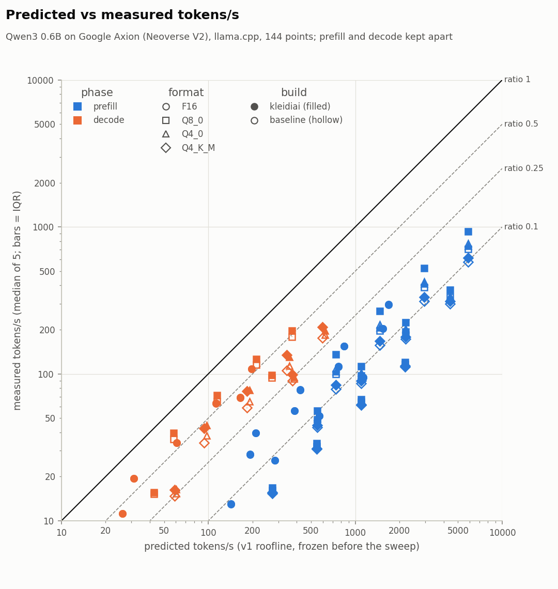
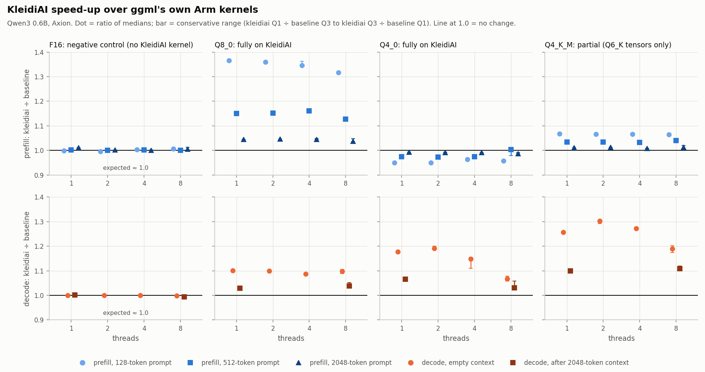
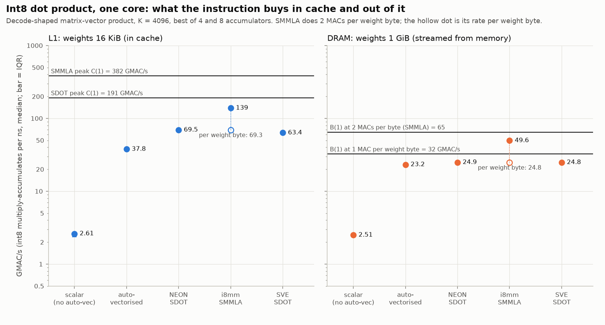

# Report: LLM inference speed on Arm Neoverse V2, predicted and measured

**Citation key.** Tables are in `results/processed/`: `points.csv` (144 sweep points), `kleidiai.csv` (72 pairs), `micro.csv`, `day8_check_a.csv`, `day8_check_b_fit.csv`, `session_bandwidth.csv`. A citation reads (`file`, `config_id` or `pair_id`); raw files are cited by path. "Computed" marks a ratio or range taken from cited rows that is not a column itself. ADR numbers refer to [CLAUDE.md](../CLAUDE.md) §15.

## 1. Question and setup

**Question.** For small LLMs on an Arm CPU: which hardware limit sets the speed of each phase, how close does llama.cpp get to it, and what do Arm's KleidiAI kernels change?

**Setup.** One Google Cloud `c4a-highcpu-8` (Google Axion, Neoverse V2): 8 cores, one thread each, L2 2 MiB per core, L3 80 MiB, NEON dotprod, i8mm, SVE2 at 128 bits, no SME (`results/raw/env/2026-10-31T2015Z.json`). llama.cpp `ddf48f8` is built twice, `baseline` and `kleidiai` (`-DGGML_CPU_KLEIDIAI=ON`) (`results/raw/build/2026-11-01T1727Z_build.json`). The baseline is not naive: ggml already repacks Q4_0, Q4_K, Q6_K and Q8_0 for NEON and i8mm. The model is Qwen3 0.6B as F16, Q8_0, Q4_0 and Q4_K_M (default `llama-quantize` mix, ADR-010; the 1.7B model left the sweep, ADR-024). The sweep has t ∈ {1, 2, 4, 8}, prompts of 128, 512 and 2048 tokens (pp), 128 generated tokens (tg128), and tg128 after a 2048-token context at t = 1 and 8: 144 points, each with a warm-up and 5 repetitions, median and IQR from the per-repetition samples, thread i pinned to core i.

Predictions were committed in `c29a00e` (2026-11-02 22:11 UTC), before the sweep records in `3d6690f` (2026-11-03 03:28 UTC). The sweep's environment capture names `c29a00e` with `dirty: false` (`results/raw/env/2026-11-02T2215Z.json`). The largest IQR/median is 2.9 % (`points.csv`, `small_Q4_0_baseline_t8_tg128d2048`). Six first attempts, all at t = 8, were noisy and re-run; none stayed above 5 %.

## 2. Measured machine limits

| t | B(t) GB/s (v1) | B₁(t) GB/s, one stream | B(t), sweep session start → end |
|---|---|---|---|
| 1 | 37.32 | 27.96 | 37.04 → 37.65 |
| 2 | 73.13 | 54.27 | 74.52 → 74.61 |
| 4 | 135.72 | 100.41 | 141.09 → 142.89 |
| 8 | 237.23 | 181.84 | 254.51 → 254.45 |

*Table 1. Read-only bandwidth. v1 inputs: `points.csv`, columns `B`, `B1`. Sweep session: `session_bandwidth.csv`; drift ≤ 1.64 %.*

**Bandwidth.** B(t) is the best valid read variant over 1, 2, 4 and 8 streams per thread. One stream per core reaches about 75 % of it (27.96/37.32 at t = 1). The sweep session's B(8) is 7.3 % above v1's input (`session_bandwidth.csv`, `session_over_v1`); v1 stayed frozen and `points.csv` also holds `ratio_session_B`.

**Compute.** Every instruction class issues 4 per cycle per core at t = 1. Per-core ceilings: `SDOT` 382, `SMMLA` 765, FP16 `FMLA` 191, `FMLALB`/`FMLALT` 95.6, F32 `FMLA` 95.6 GOPS (`points.csv`, `C_weight` of `small_Q4_0_baseline_t1_tg128`, `small_Q4_0_baseline_t1_pp128`, `small_F16_baseline_t1_pp128`, `small_F16_baseline_t1_tg128`; `C_attn` of the last). C(t) is t times these (ADR-023).

**Throttling.** Each 100 ms repetition runs at the full rate or at exactly half. At t = 1 the `SDOT` and `SMMLA` loops ran at full rate in all 20 repetitions (best chain count); the FP16 and F32 classes did so in 60–70 % of them and `FMLALB`/`FMLALT` in 40 %. At t = 8 at most 10 % of repetitions in any class ran at full rate (computed: share of samples above 75 % of full rate). At t = 8 the mean is 6.0–7.0 × 10⁹ instructions/s per core in all five classes, against 11.95 × 10⁹ at full rate (`results/raw/peak/2026-11-02T2141Z.json`). With all cores busy, the usable ceiling is about half of what v1 divides by; `points.csv` carries a sustained-ceiling ratio (`ratio_sustained`). The cause is not confirmed (power management of high-power vector instructions is the likely one). SVE is 128 bits wide, the same as NEON.

## 3. Roofline v1

All inputs are measured. **Decode:** bytes per token = `W_blk + W_out + KV(c)` from the file's tensor table; tokens/s = 1 / max(bytes / B(t), FLOPs / C(t)), with `SDOT` as the weight peak for quantised formats and `FMLALB`/`FMLALT` for F16. **Prefill:** weight FLOPs (the last layer's FFN runs for one output token) at the `SMMLA` peak, or FP16 `FMLA` for F16, plus attention FLOPs `2·L·H·d·P(P+64)` at the F32 `FMLA` peak, against bytes `⌈P/512⌉·W_blk + W_out`. Both builds get the same bytes (ADR-016). All 48 decode points bind on memory and all 96 prefill points on compute (`points.csv`, `binding`). No ratio exceeds 1.

Also drawn from `points.csv`: the [roofline plot](../figures/roofline.png) and the [ratio heat map](../figures/ratio_breakdown.png) (every format, build, thread count and test).

## 4. Results by research question

### RQ1: decode and the bandwidth ceiling

Decode measured ÷ predicted is 0.239–0.677 over 48 points, median 0.399 (computed; lowest `small_Q4_K_M_baseline_t8_tg128d2048`, highest `small_Q8_0_kleidiai_t1_tg128`).

- **By format** (baseline, t = 1 → 8): F16 0.624 → 0.546, Q8_0 0.615 → 0.482, Q4_0 0.390 → 0.296, Q4_K_M 0.363 → 0.294 (`points.csv`, `small_<format>_baseline_t{1,8}_tg128`).
- **Not compute-bound either:** at most 0.242 of the `FMLAL`/`SDOT` ceiling (`small_F16_baseline_t1_tg128`, `fraction_of_C`).
- **Inverse-bytes rule:** holds from F16 to Q8_0 at t = 1: tokens/s rise 1.85× (19.41 → 35.84) as bytes fall 1.87× (1,199,251,456 → 640,516,096) (computed; `small_F16_baseline_t1_tg128`, `small_Q8_0_baseline_t1_tg128`). It fails from Q8_0 to Q4_0: 1.06× (35.84 → 37.995) against 1.67× (640,516,096 → 382,635,008; `small_Q4_0_baseline_t1_tg128`).
- **Thread scaling:** no plateau to 8 threads, but sub-linear at every step. Q4_0 baseline: 37.995, 64.878, 113.688, 183.727 tokens/s at t = 1, 2, 4, 8 (`small_Q4_0_baseline_t{1,2,4,8}_tg128`), ratio 0.390 → 0.340 → 0.321 → 0.296. F16 rises 5.57× (19.41 → 108.06) while B(8)/B(1) is 6.36 (computed; `small_F16_baseline_t{1,8}_tg128`, `B`). All eight format × build series lose ratio at every step ([thread-scaling figure](../figures/thread_scaling.png)).
- **Depth 2048:** at t = 1, F16 bytes grow from 1,199,251,456 to 1,434,132,480 but tokens/s fall from 19.41 to 11.17 (`small_F16_baseline_t1_tg128`, `..._tg128d2048`). The KV-bytes term does not explain the fall; the cause is not measured.

**Microbenchmark comparison.** A plain `SDOT` matrix–vector loop on one core streams weights at 24.90 GB/s from 1 GiB (`micro.csv`, `sdot_a8`, DRAM, `weight_gbs`). llama.cpp's Q4_0 decode at t = 1 moves 14.54 GB/s, and the KleidiAI build 17.11 (`points.csv`, `small_Q4_0_baseline_t1_tg128`, `small_Q4_0_kleidiai_t1_tg128`, `achieved_GBps`). The loop is 1.7× faster (computed), so part of the shortfall is software. It reaches 0.768 of that session's B(1) of 32.42 GB/s (`micro.csv`, `fraction_of_B`), so it too stays below B(1).

**The Q6_K output layer.** In the Q4_0 file the output layer is Q6_K: 127,626,240 of the 375,352,320 weight bytes (`results/models/small_Q4_0.json`; `points.csv`, `bytes` of `small_Q4_0_baseline_t1_pp128`). Making it Q4_0 raises baseline tg128 at t = 1 from 37.59 to 48.99 tokens/s (`day8_check_a.csv`, `Q4_0`, `Q4_0outq4`, `baseline_median`; ADR-027). ggml's Q6_K GEMV is slow, and part of the 4-bit formats' low ratio comes from it.

**Verdict RQ1: not supported for this model size.** Decode never exceeds the memory ceiling. At tg128 F16 and Q8_0 reach 0.48–0.68 of it and the 4-bit formats 0.29–0.46 (0.24–0.28 after a 2048-token context), and the fraction falls with threads. Decode sits below both ceilings. Whether it becomes bandwidth-bound for a larger model is not measured (ADR-024).

### RQ2: prefill and the compute ceiling

Prefill ratios are 0.051–0.188, median 0.091 (computed; `small_Q4_K_M_baseline_t8_pp2048`, `small_F16_baseline_t1_pp128`). Against the sustained ceiling they are 0.066–0.337 (`ratio_sustained`; `small_Q4_K_M_baseline_t1_pp2048`, `small_F16_kleidiai_t8_pp128`).

- **Memory is not the limit:** weight traffic is at most 0.0194 of B(t) (`small_Q8_0_kleidiai_t8_pp128`, `fraction_of_B`).
- **Longer prompts do worse:** pp128 0.098–0.188, pp512 0.068–0.147, pp2048 0.051–0.092 (computed). Attention grows with P² and runs far below its ceiling.
- **Scaling holds to 4 threads and weakens at 8:** Q4_0 baseline pp512 rises 51.05 → 203.59 tokens/s from t = 1 to 4 (3.99×) and reaches 335.79 at t = 8 (6.58×); F16 reaches 7.18× (computed; `small_Q4_0_baseline_t{1,4,8}_pp512`, `small_F16_baseline_t{1,8}_pp512`). At t = 8 the sustained `SMMLA` ceiling is 3.60 × 10¹² operations/s against 6.12 × 10¹² at full rate (`C_weight_sustained`, `C_weight`; `small_Q4_0_baseline_t8_pp512`). That is consistent with throttling; it is not isolated.
- **Attention in plain C:** in `perf` profiles of pp128 at t = 1, `ggml_compute_forward_flash_attn_ext_tiled` takes 55.25 % of samples (Q4_0 baseline), 51.89 % (Q4_0 KleidiAI), 50.20 % (Q8_0 baseline) and 63.41 % (Q8_0 KleidiAI) (`results/raw/perf/2026-11-04T1742Z/small_{Q4_0,Q8_0}_{baseline,kleidiai}_t1_pp128.json`; they include model load). On SVE builds the SIMD GEMM helper of this kernel is compiled out (`simd-gemm.h:8`, ADR-020). Its 1,824 instructions hold 3 scalar `fmadd` and no vector FMA, in both builds (`results/raw/peak/2026-11-02T2141Z_ggml_f16_instructions.json`). v1 counts attention at the F32 `FMLA` peak, which a scalar loop cannot approach.

**Verdict RQ2: partially supported.** Prefill is compute-side: negligible memory traffic, near-linear scaling to 4 threads. It reaches 5–19 % of the v1 compute ceiling (7–34 % of the sustained one), and about half of its time is in scalar attention.

### RQ3: KleidiAI against ggml's own Arm kernels

| Format (coverage) | t | pp128 | pp512 | pp2048 | tg128 | tg128 after 2048 |
|---|---|---|---|---|---|---|
| F16 (control) | 1 | 0.999 (0.999–0.999) | 1.002 (1.002–1.003) | 1.010 (1.009–1.011) | 1.000 (1.000–1.000) | 1.001 (1.001–1.002) |
| F16 (control) | 8 | 1.006 (1.002–1.009) | 1.001 (1.001–1.001) | 1.005 (1.002–1.013) | 0.999 (0.996–1.001) | 0.994 (0.993–0.995) |
| Q8_0 (full) | 1 | 1.365 (1.365–1.366) | 1.150 (1.149–1.153) | 1.044 (1.040–1.045) | 1.101 (1.096–1.102) | 1.030 (1.029–1.031) |
| Q8_0 (full) | 8 | 1.316 (1.314–1.317) | 1.127 (1.127–1.128) | 1.037 (1.035–1.048) | 1.097 (1.089–1.105) | 1.038 (1.032–1.051) |
| Q4_0 (full) | 1 | 0.950 (0.950–0.950) | 0.975 (0.975–0.975) | 0.993 (0.992–0.993) | 1.177 (1.177–1.179) | 1.066 (1.063–1.066) |
| Q4_0 (full) | 8 | 0.957 (0.955–0.958) | 1.004 (0.979–1.004) | 0.986 (0.986–0.990) | 1.067 (1.058–1.078) | 1.030 (1.026–1.058) |
| Q4_K_M (partial) | 1 | 1.068 (1.067–1.070) | 1.034 (1.033–1.034) | 1.011 (1.011–1.012) | 1.256 (1.255–1.256) | 1.099 (1.099–1.099) |
| Q4_K_M (partial) | 8 | 1.064 (1.063–1.065) | 1.041 (1.040–1.043) | 1.012 (1.007–1.020) | 1.190 (1.175–1.202) | 1.109 (1.107–1.120) |

*Table 2. KleidiAI ÷ baseline speed-up of medians, with the conservative range (kleidiai Q1 ÷ baseline Q3 to kleidiai Q3 ÷ baseline Q1). Source: `kleidiai.csv`, `speedup`, `speedup_lo`, `speedup_hi`; `pair_id` = `small_<format>_t<t>_<test>`.*

**Control.** F16 stays at 0.994–1.010 over all 18 pairs (`kleidiai.csv`, `small_F16_t8_tg128d2048` to `small_F16_t1_pp2048`). The two builds differ only in KleidiAI.

**Which phase gains** depends on the format. Q8_0 gains most in short-prompt prefill (up to 1.365, `small_Q8_0_t1_pp128`) and less in tg128 (1.101 at t = 1). Q4_0 and Q4_K_M gain in decode (up to 1.191 and 1.303; `small_Q4_0_t2_tg128`, `small_Q4_K_M_t2_tg128`) and little in prefill. Q4_0 prefill is slower under KleidiAI at short prompts: 0.950 at pp128, t = 1.

**Mechanisms (ADR-027).**
- **On pure Q4_0 matrices KleidiAI's GEMV is slower than ggml's repack here; its decode gain is the 6-bit output layer.** With `output.weight` as Q4_0 the KleidiAI decode speed-up at t = 1 falls from 1.154 to 0.971 (t = 8: 1.026 → 0.922); with Q8_0 it is 1.005 (t = 8: 0.928) (`day8_check_a.csv`, `Q4_0`, `Q4_0outq4`, `Q4_0outq8`). KleidiAI replaces ggml's slow Q6_K GEMV on that layer with an 8-bit one.
- **The prefill difference is per token.** The time difference grows 14.4–16.4× from P = 128 to 2048 for Q8_0 and 14.6–25.3× for Q4_0 at t = 1, 2, 4; 16 would be a pure per-token cost, 1 a fixed cost (`day8_check_b_fit.csv`, `growth_2048_over_128`; Q4_0 at t = 8 changes sign and has no value).
- **Kernel shares.** The Q8_0 GEMM is 42.35 % of baseline samples (`ggml_gemm_q8_0_4x8_q8_0`) and 20.32 % of KleidiAI samples (`kai_kernel_matmul_clamp_f32_qai8dxp4x8_qsi8cxp4x8_16x4_neon_i8mm`). Attention is the same code in both builds, so its share rises from 50.20 % to 63.41 % and the end-to-end gain shrinks with prompt length. For Q4_0 the GEMM is 36.49 % (`ggml_gemm_q4_0_4x8_q8_0`) against 39.72 % in KleidiAI's kernel (five unnamed `perf` symbols, `label_3` to `label_7`, summed; `results/raw/perf/2026-11-04T1742Z/small_Q4_0_{baseline,kleidiai}_t1_pp128.json`): no smaller a share.

**Roofline consistency.** In decode the formats furthest below the ceiling gain most (Q4_K_M baseline ratio 0.29–0.36, speed-up 1.19–1.30; Q8_0 0.48–0.62, speed-up 1.09–1.10), but that gain is a kernel fix, and KleidiAI ratios stay ≤ 0.68. In prefill every baseline sits at 5–19 % of its ceiling, yet speed-ups run from 0.950 to 1.365, so distance from the ceiling does not predict the gain.

**Verdict RQ3: partially supported.** The effect is measured per format and phase, and the F16 control is flat. The roofline does not predict where KleidiAI helps, and on pure Q4_0 matrices it is slower.

### RQ4: instruction level

| Variant | L1: GMAC/s | × scalar | % of peak | DRAM: weight GB/s | × scalar | % of B(1) |
|---|---|---|---|---|---|---|
| scalar | 2.6 | 1.0 | n/a | 2.51 | 1.0 | 7.7 |
| auto-vectorised | 37.8 | 14.5 | n/a | 23.22 | 9.3 | 71.6 |
| `SDOT` | 69.5 | 26.6 | 36.4 | 24.90 | 9.9 | 76.8 |
| `SMMLA` | 138.6 | 53.0 (26.5 per weight byte) | 36.3 | 24.80 | 19.8 (9.9 per weight byte) | 76.5 |
| SVE `SDOT` | 63.4 | 24.3 | 33.6 | 24.85 | 9.9 | 76.6 |

*Table 3. One core, int8 matrix–vector product, K = 4096 (`micro.csv`, fastest accumulator count per family and working set). L1 set 16 KiB, DRAM set 1 GiB. "% of peak" is the p90 rate over the roofline's C(1); "% of B(1)" is over this session's B(1) of 32.42 GB/s (`results/raw/bandwidth/2026-11-04T1742Z_start.json`).*

- **In cache,** `SDOT` is 26.6× and `SMMLA` 53.0× scalar per MAC (26.5× per weight byte). GCC's auto-vectorised loop used one SVE `SDOT` with a single accumulator (`results/raw/micro/2026-11-04T1742Z.json`, `disasm.autovec`). L1 scalar is noisy (IQR/median 0.111), so these factors carry about that uncertainty.
- **`SDOT` reaches 36 % of its peak in L1.** It needs two 16-byte loads per `SDOT`, and `SDOT` and `SMMLA` read weights at the same L1 rate (69.46 and 69.32 GB/s). Likely load-limited; not verified.
- **From DRAM** every hand-written SIMD variant reads 24.78–24.90 GB/s, about 9.9× scalar per weight byte; the auto-vectorised loop reads 23.22. The instruction stops mattering.
- **Against RQ3:** the in-cache gain does not carry over. KleidiAI and ggml's repack both use `SDOT` and `SMMLA`, so RQ3 compares two SIMD kernels, and prefill reaches 1.6–17.9 % of C (`points.csv`, `fraction_of_C`), below this loop's 36 %.
- **Against RQ1:** the collapse matches in direction, but llama.cpp's 14.54 GB/s is below the 24.90 GB/s any of these loops reaches, so the instruction is not why llama.cpp falls short of B(1).

**Verdict RQ4: partially supported.** The in-cache gain (24–53× over scalar per MAC) and the DRAM collapse (hand-written variants within 0.5 % of each other) are measured, and every variant matched scalar bit for bit (`results/raw/micro/2026-11-04T1742Z.json`, `check`). The in-cache gain does not predict RQ3's prefill result, and the DRAM result does not explain llama.cpp's shortfall.

## 5. Gap accounting

Named sources from CLAUDE.md §8, each *measured*, *supported* or *not measured*.

- **Dequantisation and scale arithmetic:** not measured. Only activation quantisation is seen: 1.35–1.47 % of pp128 baseline samples (`ggml_quantize_mat_q8_0_4x8`, `results/raw/perf/2026-11-04T1742Z/small_{Q4_0,Q8_0}_baseline_t1_pp128.json`).
- **Thread synchronisation:** not measured. The falling ratio with t (RQ1) is consistent with it, not isolated.
- **Non-matmul ops:** measured for pp128 at t = 1 only, each small across the four profiles: RMS norm 1.07–1.44 %, SwiGLU 0.90–1.17 %, RoPE 0.42–0.56 %, softmax 0.40–0.49 % of samples (`results/raw/perf/2026-11-04T1742Z/`). Not measured for decode.
- **Achieved versus peak bandwidth:** supported. One stream per core reaches 75 % of B(t); a plain `SDOT` loop reaches 24.90 GB/s (`micro.csv`); llama.cpp's Q4_0 reaches 14.54 (`points.csv`).
- **Load-time conversion:** measured in size: the KleidiAI build holds 28.4 MiB more weights for Q4_0 and 38.8 MiB more for Q4_K_M (CLAUDE.md §11; `results/raw/build/2026-11-01T1727Z_check_builds.json`). The net decode effect is positive.
- **Attention in plain C:** supported (RQ2): 50.20–63.41 % of pp128 samples; no vector FMA in the kernel.
- **Sustained throttling:** measured on register-only loops (§2); its effect on llama.cpp kernels is not measured.
- **Bandwidth drift:** session `2026-11-04T1742Z` measured B(1) = 32.42 GB/s at its start and 33.83 at its end, 13 % below v1's 37.32, while B(8) was 236.01 and 228.19 (`results/raw/bandwidth/2026-11-04T1742Z_{start,end}.json`). The VM was restarted, probably onto another host; not confirmed. The sweep session drifted at most 1.64 %.
- **Unexplained:** F16 decode at 0.55–0.62 of B(t) with `fraction_of_C` ≤ 0.242 (`points.csv`, `small_F16_baseline_t{1,8}_tg128`); the larger-than-KV slowdown at depth 2048 (RQ1); the Q4_0 prefill loss under KleidiAI beyond the per-token finding.

## 6. Limitations

- One machine, one 0.6B model, batch 1. Decode for larger models is not measured.
- No accuracy study. KleidiAI re-quantises Q8_0 rows at load; perplexity was not checked.
- The cloud host is shared; B(8) varied across sessions (225–237 GB/s on 2026-11-02, CLAUDE.md §11; 228–236 on 2026-11-04). The cause of the throttling is not confirmed.
- The end-of-sweep environment capture is missing (`results/raw/env/2026-11-02T2215Z_end.json` does not exist); the end-of-sweep bandwidth record exists (`results/raw/bandwidth/2026-11-02T2215Z_end.json`).
- `perf` profiles include model load and are not data for tokens/s.
- The first figure set was drawn locally with matplotlib 3.10.8, not the pinned 3.11.2; the committed figures were redrawn on the VM (CLAUDE.md §16).

## 7. Reproduce

See the [README](../README.md). `make test` runs anywhere; the measurements need a Google Cloud `c4a-highcpu-8` VM.
